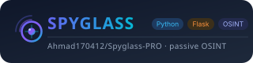
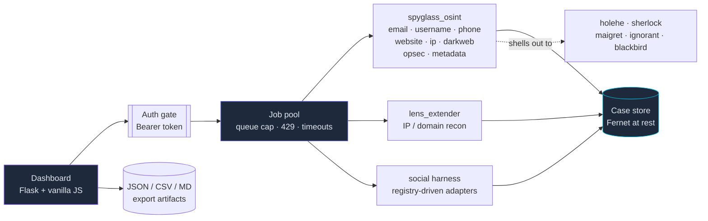

<div align="center" markdown="1">



# Spyglass-Pro

### One dashboard. Three recon engines. **Zero packets sent to your target.**

[](https://github.com/Ahmad170412/Spyglass-PRO/actions)
[](https://pypi.org/project/spyglass-pro/)
[](LICENSE)
[](https://www.python.org/)
[](#passive-only)
[](CONTRIBUTING.md)

[**Quick Start**](#quick-start) · [**Features**](#features) · [**Architecture**](#architecture) · [**Configuration**](#configuration) · [**API**](#api) · [**Changes**](CHANGELOG.md) · [**Contributing**](CONTRIBUTING.md) · [**Security**](.github/SECURITY.md) · [**Audit**](AUDIT-2026-10.md)

</div>

---


## Why Spyglass-Pro?

Most OSINT tooling is a pile of scripts that assume you already know what to
run, in what order, and how to read the output. Spyglass-Pro is a single
dashboard that answers a different question: **what is actually knowable about
a target, and how do I know the answer is real?**

- **Three engines, one interface.** Spyglass-OSINT, a stealth social harness,
  and Lens-Extender are merged behind a single job pool that runs them in
  parallel and correlates the entities they each find.
- **Passive by construction, not by policy.** Every probe that touched a
  target was *deleted*, not disabled — no flag, env var or config path brings
  it back. The [audit](AUDIT-2026-10.md#active-scanning-removed) lists every
  one so it can't quietly reappear.
- **It refuses to lie to you.** A follower list behind a login is reported as
  *walled with a reason*, never as an empty list. A recon leg that can't run
  is named in `/api/status`. A partial result never renders like a complete one.
- **Honest degradation is a feature, not a bug report.** Run it bare and it
  tells you exactly which panels are breach-only instead of quietly showing
  you nothing.

> **Built for people who need the truth.** OSINT tools are dual-use. Only
> investigate systems and accounts you own or have explicit permission to
> test. See [Responsible use](#responsible-use).

---

## Table of Contents

- [Quick Start](#quick-start)
- [Features](#features)
- [Architecture](#architecture)
- [Installation](#installation)
- [Optional CLI engines](#optional-cli-engines)
- [Passive-only](#passive-only)
- [Configuration](#configuration)
- [API](#api)
- [Cases](#cases)
- [Testing](#testing)
- [Platforms](#platforms)
- [Project structure](#project-structure)
- [Contributing](#contributing)
- [Changelog](CHANGELOG.md)
- [Responsible use](#responsible-use)
- [License](#license)

---

## Quick Start

Copy-paste ready. No API keys, no accounts, no configuration.

```bash
pip install spyglass-pro
spyglass-pro
```

Or from source:

```bash
git clone https://github.com/Ahmad170412/Spyglass-PRO.git && cd Spyglass-PRO
python3 -m venv .venv && source .venv/bin/activate
pip install -e .

python run.py
```

Open <http://127.0.0.1:5000>.

That's it — **Website**, **IP Address**, **Full Investigation** and the
keyless social panels (**GitHub**, **Mastodon**, **Bluesky**) work
immediately on a bare install. To light up the email/username/phone panels:

```bash
python scripts/install_tools.py --check    # see what's missing
python scripts/install_tools.py            # install the missing ones
```

`run.py` adds the venv, pipx and blackbird locations to `PATH` itself, so the
server finds your engines even when launched from cron, a container or a
launch agent instead of a login shell.

---

## Features

| Feature | What it actually does |
| --- | --- |
| **Website** | DNS records, SPF/DMARC/CAA, passive subdomains from crt.sh + CertSpotter + HackerTarget + Wayback, WHOIS with IANA referral-following, history |
| **Email** | holehe + user-scanner + blackbird sweeps, cross-tool agreement, LeakCheck + Scylla breach data |
| **Username** | sherlock + maigret + user-scanner + blackbird, with four-way overlap categories |
| **Phone** | phoneinfoga + ignorant, plus breach correlation |
| **IP Address** | InternetDB, RDAP, RIPEstat, reverse DNS, DNSBL, Shodan |
| **Dark web** | Ahmia onion-index search, LeakCheck + Scylla breach data, keyed IntelX + HIBP |
| **Investigation** | Runs every engine in parallel and correlates shared emails, IPs, domains and usernames |
| **OPSEC** | Local self-check: your real IP, proxy status, DNS-leak exposure, timezone/geo fingerprint risk |
| **Metadata** | ExifTool + PDF/OOXML/image fallbacks, MD5/SHA-256, GPS, with file-type reconciliation |
| **Social** | Instagram (stealth browser) + Mastodon, Bluesky and GitHub (keyless, instant), one registry-driven panel |
| **Cases** | Encrypted-at-rest run history with entity diffing, timelines and dossier export |

---

## Architecture



Every box under `POOL` only ever talks to third-party services. There is no
edge from any of them to the target.

---

## Installation

**Requirements:** Python 3.10+ (tested on 3.10–3.13 in CI), macOS, Linux or
Windows.

```bash
git clone https://github.com/Ahmad170412/Spyglass-PRO.git && cd Spyglass-PRO
python3 -m venv .venv && source .venv/bin/activate
pip install -e .
```

Then:

```bash
python run.py                 # serves on 127.0.0.1:5000 (waitress; Flask dev server only with --debug)
python -m spyglass_pro        # equivalent
spyglass-pro                  # console entry point
```

<details>
<summary><b>Social recon needs one more package — for Instagram only</b></summary>

The Instagram panel drives a real browser via `cloakbrowser`, which is
deliberately **not** a core dependency — it pulls a ~200 MB browser binary and
wants a license key:

```bash
pip install cloakbrowser
```

GitHub, Mastodon and Bluesky are keyless JSON sources: they need no browser,
no account and no key, and work on a bare install.

</details>

---

## Optional CLI engines

The **email**, **username** and **phone** modules are orchestrators: they shell
out to external CLI engines rather than collecting themselves.

```bash
python scripts/install_tools.py --check    # report which are missing
python scripts/install_tools.py            # install the missing ones
```

This covers sherlock, maigret, holehe, ignorant, blackbird, user-scanner,
shodan, phoneinfoga, exiftool, dig/whois/curl and torsocks — every tool the
dashboard can detect. The script is idempotent — re-running it only installs
what is still missing. Python CLIs install via pipx (isolated venvs, no
dependency conflicts); system tools via brew or apt.

### What you get without them

Degrading without an error is not the same as being useful, so here is exactly
what a bare install can and cannot do:

| Module | With engines | Without engines |
| --- | --- | --- |
| Email | holehe + user-scanner + blackbird sweeps, plus breach | **breach data only** |
| Username | sherlock + maigret + user-scanner + blackbird sweeps, plus breach | **breach data only** |
| Phone | phoneinfoga + ignorant, plus breach | **breach data only** |

Breach checking (LeakCheck + Scylla) needs no account and no CLI tool, so it
works on a bare install. **Website**, **IP Address** and **Full
Investigation** need no external *recon* engines and work immediately.

To confirm what the running server can see, `GET /api/status` returns a
per-tool `true`/`false` map, a `missing_tools` list and a per-panel `degraded`
map.

> `holehe` and `ignorant` enumerate which platforms an email or phone number is
> registered on. That is active account enumeration against third-party
> services and it sits against Spyglass-Pro's passive-only posture. Only use
> them on identifiers you own or have permission to test.

---

## Passive-only

**Spyglass-Pro never opens a connection to a target.** Every query goes to a
third party: DNS resolvers, Certificate Transparency logs, WHOIS registries,
InternetDB, RDAP, RIPEstat, Wayback, crt.sh, CertSpotter, HackerTarget and
breach databases. Shodan, GreyNoise, Censys, AbuseIPDB, VirusTotal and NVD
enrichment are wired but need an API key.

There is no port scan, no directory brute force, no HTTP probing of discovered
hosts, no zone-transfer attempt and not even a fetch of the target's homepage.
That code was **removed, not disabled** — the
[audit inventory](AUDIT-2026-10.md#active-scanning-removed) lists every
removed function, so none of it can be switched back on by configuration or a
stray flag.

**Where the line sits:** ordinary DNS record lookups (A, MX, NS, TXT, SPF,
DMARC, CNAME) are still made, because no useful host recon exists without them
and every OSINT tool treats them as passive.

**What that costs you, plainly:** no HTTP headers, no TLS certificate or cipher
details, no technology fingerprinting, no robots.txt or sitemap, no page
content, no favicon hash and no exposed-file findings. Active collection lives
in a separate project.

---

## Configuration

All settings are environment variables (CLI flags exist for the basics — see
`spyglass-pro --help`):

| Variable | Default | Purpose |
| --- | --- | --- |
| `SPYGLASS_PRO_HOST` | `127.0.0.1` | Bind address |
| `SPYGLASS_PRO_PORT` | `5000` | Port |
| `SPYGLASS_PRO_TOKEN` | — | Require this Bearer token on every `/api/*` route |
| `SPYGLASS_PRO_SECRET` | random per process | Flask `SECRET_KEY` |
| `SPYGLASS_PRO_DEBUG` | `0` | Werkzeug debug mode (**RCE console — never enable on a reachable host**) |
| `SPYGLASS_PRO_MAX_QUEUE` | `16` | Max pending scan jobs before a 429 |
| `SPYGLASS_PRO_JOB_TIMEOUT` | `900` | Seconds a request waits for a job |
| `SPYGLASS_PROXY` | — | Proxy for every outgoing query |
| `SPYGLASS_HOME` | `~/.spyglass` | Case store location |
| `SPYGLASS_STORE_KEY` | — | Base64 32-byte Fernet key for data at rest |
| `SPYGLASS_STORE_PASS` | — | Derive the Fernet key from a password instead |

**Non-loopback deployments** must set `SPYGLASS_PRO_TOKEN`; the server warns at
startup if you don't:

```bash
SPYGLASS_PRO_TOKEN=$(openssl rand -hex 24) python3 run.py
```

---

## API

Every route is under `/api/*` and requires the Bearer token when
`SPYGLASS_PRO_TOKEN` is set.

```bash
# What's installed, what's missing, what degraded
curl -H "Authorization: Bearer $TOKEN" http://127.0.0.1:5000/api/status

# Run a module
curl "http://127.0.0.1:5000/api/spyglass/run?module=website&target=example.com" \
     -H "Authorization: Bearer $TOKEN"

# Correlated multi-input investigation
curl -X POST http://127.0.0.1:5000/api/investigate/run \
     -H "Authorization: Bearer $TOKEN" \
     -H "Content-Type: application/json" \
     -d '{"website":"example.com","email":"user@example.com"}'

# Stored-run queries
curl "http://127.0.0.1:5000/api/cases/diff?target=example.com&qtype=website" \
     -H "Authorization: Bearer $TOKEN"
```

| Endpoint | Purpose |
| --- | --- |
| `GET /api/status` | Engines, platforms, per-tool availability, `missing_tools`, `degraded` |
| `GET /api/spyglass/run` | Run one spyglass module (`module`, `target`, + flags) |
| `GET /api/lens/run` | Lens-Extender passive recon |
| `POST /api/investigate/run` | Parallel multi-input investigation |
| `GET /api/social/platforms` | Registered adapters and their capabilities |
| `POST /api/social/run` | Collect one social profile |
| `GET /api/cases` · `/diff` · `/timeline` · `/profile` | Stored-run queries |
| `DELETE /api/cases/run` | Delete one stored run (and its entity rows) |
| `GET /api/jobs` · `/api/job/<id>` · `/api/stream/<id>` | Async job registry, polling, live SSE log |
| `GET /api/settings` · `POST /api/settings` | API-key vault (masked read) and proxy config |
| `GET /api/healthz` | Liveness plus pool saturation |
| `GET/POST /api/proxy` | Read or set the outbound proxy (scheme-validated) |

A busy server returns **HTTP 429** for a full job queue, distinct from a scan
that ran and failed — so a client can tell back-pressure from a broken payload.

---

## Cases

Every scan can be stored. Stored runs keep a full result snapshot plus an
entity index (domains, IPs, emails, phones, orgs, onions, breaches), which is
what the **Stored Cases** panel reads:

- **Diff last two runs** — entities that appeared or disappeared since the
  previous run of the same target and query type.
- **Timeline** — every stored run of a target, oldest first.
- **Export dossier** — the latest run per query type merged into one JSON
  profile.

Data at rest is encrypted with Fernet when `SPYGLASS_STORE_KEY` or
`SPYGLASS_STORE_PASS` is set; otherwise it is stored in plaintext. JSON/CSV/
report artifacts from a scan land in the working directory of the run.

---

## Testing

```bash
.venv/bin/python tests/run_tests.py
```

**481 offline checks** — the three engines' own suites plus the merge layer
(API surface, auth gate, proxy validation, job pool, target validation, case
queries, cross-platform filename and decoding behaviour) and the node-checked
dashboard JS. No network, no browser, finishes in a few seconds.

CI runs the suite on Python 3.10–3.13 (plus macOS and Windows), type-checks
with `mypy`, lints with `ruff`, `node --check`s the dashboard JS, and asserts
the built wheel actually carries `LICENSE`, `NOTICE` and all three vendored
engines.

---

## Platforms

macOS, Linux and Windows are supported. CI runs the suite on Ubuntu
(Python 3.10–3.13) and macOS; Windows ships documented fallbacks for the
tools it lacks. Two platform differences are worth knowing before you file
a bug:

- **Windows has no `dig` or `whois`.** The DNS legs fall back to Python's
  resolver and the HTTP legs to `urllib`, so the modules still run — but DNS
  record tables, SPF/DMARC and WHOIS come back thinner until you install the
  tools. `GET /api/status` lists exactly which are missing on your machine.
- **Windows reserved filenames.** `CON`, `PRN`, `AUX`, `NUL`, `COM1`–`COM9` and
  `LPT1`–`LPT9` cannot be used as filenames in any case, so Spyglass-Pro
  prefixes them rather than producing artifacts that fail to open there.

---

## Project structure

```
run.py                     dev entry point
scripts/install_tools.py   idempotent CLI-engine installer
tests/                     481 offline checks (run_tests.py)
assets/logo.svg            README logo
spyglass_pro/
  app.py                   Flask routes + auth gate + proxy validation
  runner.py                job pool (queue cap, timeouts), engine dispatch
  social/                  multi-platform social harness (schema, registry,
                           adapters) — merge layer, not vendored
  cli.py                   `spyglass-pro` console entry point
  templates/ static/       dashboard UI
  modules/                 vendored engines (see NOTICE)
```

The three engines live behind a directory boundary on purpose, so the next sync
from upstream is mechanical. `NOTICE` records exactly where each copy differs
from its origin — including the bug fixes that exist only here.

---

## Contributing

Read [CONTRIBUTING.md](CONTRIBUTING.md). The short version: **the passive-only
rule overrides everything else**, new behaviour needs a test that fails without
it, and a partial result must never look like a complete one.

---

## Responsible use

OSINT tools are dual-use. Only investigate systems and accounts you own or
have explicit permission to test.

Instagram collection may violate those platforms' terms of service. Because
Spyglass-Pro is passive-only it does not touch a target's network — but the
social module still drives a real browser against a real account, so use burner
credentials you are willing to lose. Passive queries also disclose your
*investigation target* to third-party services and your source IP to all of
them; use a proxy if that matters to you.

You are responsible for compliance with applicable laws.

---

## License

MIT — see [LICENSE](LICENSE). One copyright holder covers this repository in
full, including the engines under `spyglass_pro/modules/`; [NOTICE](NOTICE)
records where those came from and why they are kept behind a directory
boundary.