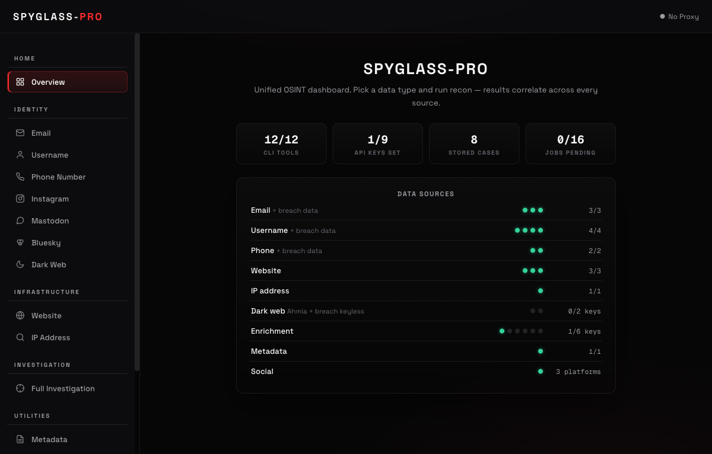

# Spyglass-Pro



Unified OSINT dashboard that wires three recon engines into one platform:

| Engine | Purpose |
| --- | --- |
| **Spyglass-OSINT** | Email / username / phone / website / IP / dark-web / OPSEC / metadata recon |
| **Social harness** | Stealth profile recon across registered platforms (Instagram today) |
| **Lens-Extender** | Long-range IP/domain recon — passive only |

The **Investigation** view runs the engines in parallel and correlates
entities across sources (shared emails, IPs, domains, usernames).

## Install

```bash
git clone <spyglass-pro-repo> && cd Spyglass-Pro
python3 -m venv .venv && source .venv/bin/activate
pip install -e .
```

Optional CLI engines (sherlock, maigret, holehe, user-scanner, ignorant,
shodan) are discovered on `PATH` when installed; every module degrades
gracefully when one is missing.

## Passive-only

**Spyglass-Pro never opens a connection to a target.** Every query goes to
a third party: DNS resolvers, Certificate Transparency logs, WHOIS
registries, InternetDB, RDAP, RIPEstat, Wayback, crt.sh, CertSpotter,
HackerTarget, and breach databases. Shodan, GreyNoise, Censys, AbuseIPDB,
VirusTotal and NVD enrichment are wired but need an API key — see
[Configuration](#configuration).

There is no port scan, no directory brute force, no HTTP probing of
discovered hosts, no zone-transfer attempt and not even a fetch of the
target's homepage. That code was **removed, not disabled** — see
[AUDIT-2026-10.md](AUDIT-2026-10.md#active-scanning-removed) for the exact
list — so none of it can be switched back on by configuration or a stray
flag.

Where the line sits: ordinary DNS record lookups (A, MX, NS, TXT, SPF,
DMARC, CNAME) are still made, because no useful host recon exists without
them and every OSINT tool treats them as passive.

What that costs you, plainly: no HTTP headers, no TLS certificate or cipher
details, no technology fingerprinting, no robots.txt or sitemap, no page
content, no favicon hash and no exposed-file findings. Active collection
lives in a separate project.

## Run

```bash
python run.py            # or: python -m spyglass_pro  /  spyglass-pro
```

Then open <http://127.0.0.1:5000>.

## Instagram recon

The **Instagram** panel collects one profile through a stealth browser.
Instagram ships today; each platform is an adapter that declares its
identity, capabilities and a `collect()` function, so adding another is a
new module plus a `@register` line.

Results are honest about what was not retrieved: a follower list that needs
a login is reported as **walled with a reason**, never as an empty list, and
a partially-retrieved list is labelled partial.

Adding a platform:

```python
# spyglass_pro/social/platforms/<name>.py
from .. import registry
from ..schema import set_fields, add_wall

def collect(page, cfg, handle, result): ...
def normalize(raw, result): ...          # pure — unit-test it offline

registry.register(registry.Platform(
    key="tiktok", label="TikTok", url="https://tiktok.com/@{handle}",
    capabilities=("profile", "bio", "follower_count"),
    login="none", collect=collect,
))
```

Then list it in `registry.load_all()` and it appears in the UI, the report
and the API with no other changes.

## Test

```bash
.venv/bin/python tests/run_tests.py
```

289 offline checks — the three engines' own suites plus the merge layer
(API surface, auth gate, proxy validation, job pool, case queries). No
network and no browser required.

## Configuration

All settings are environment variables (CLI flags exist for the basics —
see `spyglass-pro --help`):

| Variable | Default | Purpose |
| --- | --- | --- |
| `SPYGLASS_PRO_HOST` | `127.0.0.1` | Bind address |
| `SPYGLASS_PRO_PORT` | `5000` | Port |
| `SPYGLASS_PRO_TOKEN` | — | Require this Bearer token on every `/api/*` route |
| `SPYGLASS_PRO_SECRET` | random per process | Flask `SECRET_KEY` |
| `SPYGLASS_PRO_DEBUG` | `0` | Werkzeug debug mode (**RCE console — never enable on a reachable host**) |
| `SPYGLASS_PRO_MAX_QUEUE` | `16` | Max pending scan jobs before rejecting |
| `SPYGLASS_PRO_JOB_TIMEOUT` | `900` | Seconds a request waits for a job |

## Security notes

- Binds loopback-only by default; set `SPYGLASS_PRO_TOKEN` before binding
  any other address (the server warns at startup if you don't).
- Debug mode is off by default.
- Proxy URLs are validated (http/https/socks schemes only) before they
  reach the environment shared by every subprocess.
- Scan jobs are queue-capped and time-bounded; results are HTML-escaped
  and links are restricted to http/https/mailto.

## Responsible use

OSINT tools are dual-use. Only investigate systems and accounts you own or
have explicit permission to test. Instagram collection may violate
those platforms' terms of service. Because Spyglass-Pro is passive-only it
does not touch a target's network — but the social module still drives a
real browser against a real account, so use burner credentials you are
willing to lose. You are responsible for compliance with applicable laws.

## Project structure

```
run.py                  dev entry point
tests/                  289 offline checks (run_tests.py)
spyglass_pro/
  app.py                Flask routes + auth gate + proxy validation
  runner.py             job pool (queue cap, timeouts), engine dispatch
  social/               multi-platform social harness (schema, registry,
                        adapters) — merge layer, not vendored
  cli.py                `spyglass-pro` console entry point
  templates/ static/    dashboard UI
  modules/              vendored engines (see NOTICE)
```

## Cases

Every scan can be stored (`Store in Cases`). Stored runs keep a full result
snapshot plus an entity index (domains, IPs, emails, phones, orgs, onions,
breaches), which is what the **Stored Cases** panel reads:

- **Diff last two runs** — entities that appeared or disappeared since the
  previous run of the same target and query type.
- **Timeline** — every stored run of a target, oldest first.
- **Export dossier** — the latest run per query type merged into one JSON
  profile.

Data at rest is encrypted with Fernet when `SPYGLASS_STORE_KEY` (base64
32-byte key) or `SPYGLASS_STORE_PASS` is set; otherwise it is stored in
plaintext. The store location follows `SPYGLASS_HOME` (default
`~/.spyglass`). JSON/CSV/report artifacts from a scan land in the working
directory of the run.

## License

MIT — see [LICENSE](LICENSE) and [NOTICE](NOTICE) for the bundled
engines' copyrights.
