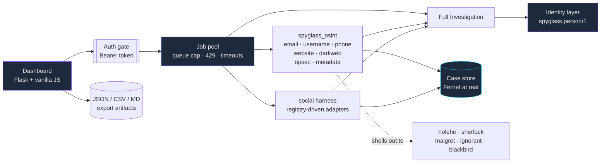

<div align="center" markdown="1">


# Spyglass-Pro

**Resolve a person, an account or a website into evidence — without ever touching the target.**
One passive OSINT dashboard: identity resolution, light website recon, breach and social sources, and an encrypted local case store.

[](https://github.com/Ahmad170412/Spyglass-PRO/actions)
[](https://github.com/Ahmad170412/Spyglass-PRO/releases)
[](https://pypi.org/project/spyglass-pro/)
[](LICENSE)
[](https://www.python.org/)
[](https://github.com/Ahmad170412/Spyglass-PRO)
[](#passive-only)
[](CONTRIBUTING.md)

[**Quick Start**](#quick-start) · [**Features**](#features) · [**Architecture**](#architecture) · [**Identity**](#identity-resolution) · [**Configuration**](#configuration) · [**API**](#api) · [**Changelog**](CHANGELOG.md) · [**Contributing**](CONTRIBUTING.md) · [**Security**](.github/SECURITY.md) · [**Audit**](AUDIT-2026-10.md)

</div>

---


## Why Spyglass-Pro?

Most OSINT tooling is a pile of scripts that assume you already know what to
run, in what order, and how to read the output. Spyglass-Pro is a single
dashboard that answers a different question: **what is actually knowable about
a target, and how do I know the answer is real?**

- **It resolves people, not just entities.** Full Investigation turns a name,
  handle, e-mail, phone or website into one *person model* — anchors,
  attributes, accounts, breaches, links, conflicts and context — instead of a
  bag of unrelated hits. A shared handle is recorded as **possible**, never as
  a merge: the tool tells you what it does not know.
- **Passive by construction, not by policy.** Every probe that touched a
  target was *deleted*, not disabled — no flag, env var or config path brings
  it back. The [audit](AUDIT-2026-10.md#active-scanning-removed) lists every
  one so it can't quietly reappear.
- **It refuses to lie to you.** A follower list behind a login is reported as
  *walled with a reason*, never as an empty list. A recon leg that can't run
  is named in `/api/status`. A partial result never renders like a complete
  one.
- **Honest degradation is a feature, not a bug report.** Run it bare and it
  tells you exactly which panels are breach-only instead of quietly showing
  you nothing.

> **Built for people who need the truth.** OSINT tools are dual-use. Only
> investigate systems and accounts you own or have explicit permission to
> test. See [Responsible use](#responsible-use).

---

## Table of Contents

- [What's new in 1.5](#whats-new-in-15)
- [Quick Start](#quick-start)
- [Features](#features)
- [Architecture](#architecture)
- [Identity resolution](#identity-resolution)
- [Installation](#installation)
- [Optional CLI engines](#optional-cli-engines)
- [Passive-only](#passive-only)
- [Configuration](#configuration)
- [Usage](#usage)
- [API](#api)
- [Cases](#cases)
- [Testing](#testing)
- [Platforms](#platforms)
- [Repository structure](#repository-structure)
- [Contributing](#contributing)
- [Responsible use](#responsible-use)
- [License](#license)

---

## What's new in 1.5

1.5 is the pivot release. Spyglass-Pro stops being an *infrastructure*
product and becomes a **HUMINT** one: the IP module, the heavy website phases
and Lens-Extender are no longer part of the product surface, and the build
gains what replaces them. The full list is in the
[changelog](CHANGELOG.md).

- **Identity resolution.** Full Investigation now resolves its inputs into a
  person model — seven layers, one value per field, list-ready — with
  `high` / `medium` / `possible` confidence on every link.
- **Website recon is light and owner-scoped.** Owner/registrant, WHOIS, basic
  DNS, SPF/DMARC/DKIM/CAA, wildcard-DNS detection and Certificate
  Transparency. A domain or an `http(s)` URL only — never a direct IP.
- **The results panel reads like a report.** A compact person grid, a
  three-column accounts table, compact links and conflicts, and `Details` /
  `Run log (N)` / `Raw JSON` as collapsed drawers.
- **A themed delete dialog** replaces `window.confirm` for stored cases.
- **The boundary is enforced, not documented.** Any module that is neither
  exposed nor explicitly dormant is refused at the API — a new engine cannot
  become reachable by accident.
- **The API-key vault is its own file** (`~/.spyglass/vault.json`) and offers
  only the two keys an exposed module actually reads.

---

## Quick Start

Copy-paste ready. No API keys, no accounts, no configuration.

```bash
pip install spyglass-pro
spyglass-pro
```

Or from source:

```bash
git clone https://github.com/Ahmad170412/Spyglass-PRO.git && cd Spyglass-PRO
python3 -m venv .venv && source .venv/bin/activate
pip install -e .

python run.py
```

Open <http://127.0.0.1:5000>.

That's it — the keyless panels (**Website**, **Full Investigation**, and the
social adapters **Bluesky**, **GitHub**, **GitLab**, **Keybase**,
**Mastodon**) work immediately. The **email**, **username** and **phone**
panels need optional CLI engines. The one-line installer ships with a
**source checkout**, not the wheel, so use it from the clone above:

```bash
python scripts/install_tools.py --check    # see what's missing
python scripts/install_tools.py            # install the missing ones
```

If you installed from PyPI (no checkout), install the engines directly — the
installer's docstring lists the exact command per tool and platform. The Python
ones go through `pipx` (isolated venvs); `blackbird` is a git clone and
`phoneinfoga` a release binary, so the script is the reliable path when you
have the source.

`run.py` adds the venv, pipx and blackbird locations to `PATH` itself, so the
server finds your engines even when launched from cron, a container or a
launch agent instead of a login shell.

---

## Features

| Feature | What it actually does |
| --- | --- |
| **Full Investigation** | Runs the modules in parallel, correlates the results and resolves them into a person model — anchors, attributes, accounts, breaches, links, conflicts, context |
| **Website** | Owner/registrant, WHOIS with referral-following, basic DNS, SPF/DMARC/DKIM/CAA, wildcard-DNS detection, certificate transparency. Domain or URL only; never a direct IP |
| **Email** | holehe + user-scanner + blackbird sweeps, cross-tool agreement, breach data |
| **Username** | sherlock + maigret + user-scanner + blackbird, with four-way overlap categories |
| **Phone** | phoneinfoga + ignorant, plus breach correlation |
| **Dark web** | Ahmia onion-index search, breach data, keyed IntelX + HIBP |
| **Social** | Instagram (stealth browser) + Bluesky, GitHub, GitLab, Keybase and Mastodon (keyless, instant), one registry-driven panel |
| **OPSEC** | Local self-check: your real IP, proxy status, DNS-leak exposure, timezone/geo fingerprint risk |
| **Metadata** | ExifTool + PDF/OOXML/image fallbacks, MD5/SHA-256, GPS, with file-type reconciliation |
| **Cases** | Encrypted-at-rest run history with entity diffing, timelines and dossier export |

The **IP Address** panel and **Lens-Extender** are not part of this build.
Their code stays in the tree for a sibling tool, but no panel and no endpoint
can reach it — see [Passive-only](#passive-only).

---

## Architecture



Every box under `POOL` only ever talks to third-party services. There is no
edge from any of them to the target. The identity layer is **additive**: it
reads the results the engines already produced and adds no endpoint, no query
type and no new store path.

---

## Identity resolution

Full Investigation does not just merge results — it resolves them. The
output is a person model (`spyglass.person/1`) with seven layers:

| Layer | What it holds |
| --- | --- |
| **Anchors** | The inputs themselves, and what a run could prove about them |
| **Attributes** | Names, locations, organisations, handles, e-mails, phones |
| **Accounts** | One row per platform, with the engines that agree and the confidence |
| **Breaches** | Where the identifiers show up in breach data |
| **Links** | Relationships between anchors, each with a confidence |
| **Conflicts** | Where two sources disagree — the interesting part |
| **Context** | Facts that are true but not identifying (a website, a country) |

**The rules it keeps:**

- A shared handle or a matching e-mail local part is **possible**, never a
  merge. Two people can own the same username; the build says so instead of
  guessing.
- A website you typed in is **context**, not an identity anchor. It never
  turns into "this is who the person is".
- Links carry `high` / `medium` / `possible`; the overall verdict carries
  `high` / `medium` / `unconfirmed`.
- One value per field — but the model is list-ready, so a field can grow.

---

## Installation

**Requirements:** Python 3.10+ (tested on 3.10–3.13 in CI), macOS, Linux or
Windows.

```bash
git clone https://github.com/Ahmad170412/Spyglass-PRO.git && cd Spyglass-PRO
python3 -m venv .venv && source .venv/bin/activate
pip install -e .
```

Then:

```bash
python run.py                 # serves on 127.0.0.1:5000 (waitress; Flask dev server only with --debug)
python -m spyglass_pro        # equivalent
spyglass-pro                  # console entry point
```

<details>
<summary><b>Social recon needs one more package — for Instagram only</b></summary>

The Instagram panel drives a real browser via `cloakbrowser`, which is
deliberately **not** a core dependency — it pulls a ~200 MB browser binary and
wants a license key:

```bash
pip install cloakbrowser
```

Bluesky, GitHub, GitLab, Keybase and Mastodon are keyless JSON sources: they
need no browser, no account and no key, and work on a bare install. The two
code forges fill the same panel shape from very different APIs — with GitLab's
unauthenticated profile being the honest *short* form (name, handle, avatar,
state, published e-mail) — so the panel's capability header never promises
what the keyless API cannot return. Keybase is the odd one out and the most
useful: it returns the account's cryptographically-**proven** identities (the
Twitter, GitHub, Reddit and Hacker News accounts the user has signed for),
which is correlation you can trust rather than infer.

</details>

---

## Optional CLI engines

The **email**, **username** and **phone** modules are orchestrators: they shell
out to external CLI engines rather than collecting themselves.

```bash
python scripts/install_tools.py --check    # report which are missing
python scripts/install_tools.py            # install the missing ones
```

This covers sherlock, maigret, holehe, ignorant, blackbird, user-scanner,
phoneinfoga, exiftool, dig/whois/curl and torsocks — every tool the
dashboard can detect. It ships with a **source checkout** (`git clone` /
`pip install -e .`), not the published wheel; a PyPI install has no
`scripts/` directory, so install the engines directly there. The script is
idempotent — re-running it only installs what is still missing. Python CLIs
install via pipx (isolated venvs, no dependency conflicts); system tools via
brew or apt.

### What you get without them

Degrading without an error is not the same as being useful, so here is exactly
what a bare install can and cannot do:

| Module | With engines | Without engines |
| --- | --- | --- |
| Email | holehe + user-scanner + blackbird sweeps, plus breach | **breach data only** |
| Username | sherlock + maigret + user-scanner + blackbird sweeps, plus breach | **breach data only** |
| Phone | phoneinfoga + ignorant, plus breach | **breach data only** |

Breach checking needs no account and no CLI tool, so it works on a bare
install. **Website** runs without any *recon* engine too, but its richer legs
depend on tools that may be absent — it uses `dig` and `whois`. **Full
Investigation** merges the modules above, so its coverage is theirs. `GET
/api/status` reports exactly which tools are missing on your machine.

> `holehe` and `ignorant` enumerate which platforms an email or phone number is
> registered on. That is active account enumeration against third-party
> services and it sits against Spyglass-Pro's passive-only posture. Only use
> them on identifiers you own or have permission to test.

---

## Passive-only

**Spyglass-Pro never opens a connection to a target.** Every query goes to a
third party: DNS resolvers, Certificate Transparency logs, WHOIS registries,
Ahmia, breach databases and social APIs.

There is no port scan, no directory brute force, no HTTP probing of discovered
hosts, no zone-transfer attempt and not even a fetch of the target's homepage.
That code was **removed, not disabled** — the
[audit inventory](AUDIT-2026-10.md#active-scanning-removed) lists every
removed function, so none of it can be switched back on by configuration or a
stray flag.

**The IP module, the heavy website phases and Lens-Extender are unexposed.**
They stay in the tree — a sibling tool consumes them — but no dashboard panel
and no API endpoint can reach them: the HTTP boundary refuses them by name.
The boundary is enforced rather than documented, and a test pins the handler
map to the exposed set, so a new engine cannot become reachable by accident.

**Where the line sits:** ordinary DNS record lookups (A, MX, NS, TXT, SPF,
DMARC, CNAME) are still made, because no useful host recon exists without them
and every OSINT tool treats them as passive.

**What that costs you, plainly:** no HTTP headers, no TLS certificate or cipher
details, no technology fingerprinting, no robots.txt or sitemap, no page
content, no favicon hash and no exposed-file findings. Active collection lives
in a separate project.

---

## Configuration

All settings are environment variables (CLI flags exist for the basics — see
`spyglass-pro --help`). **Every one of them is optional.**

| Variable | Default | Purpose |
| --- | --- | --- |
| `SPYGLASS_PRO_HOST` | `127.0.0.1` | Bind address |
| `SPYGLASS_PRO_PORT` | `5000` | Port |
| `SPYGLASS_PRO_TOKEN` | — | Require this Bearer token on every `/api/*` route |
| `SPYGLASS_PRO_ALLOWED_HOSTS` | loopback + bind | Extra `Host` values to accept when no token is set (comma-separated; `*` disables the check) |
| `SPYGLASS_PRO_SECRET` | random per process | Flask `SECRET_KEY` |
| `SPYGLASS_PRO_DEBUG` | `0` | Werkzeug debug mode (**RCE console — never enable on a reachable host**) |
| `SPYGLASS_PRO_MAX_QUEUE` | `16` | Max pending scan jobs before a 429 |
| `SPYGLASS_PRO_JOB_TIMEOUT` | `900` | Seconds a request waits for a job |
| `SPYGLASS_PROXY` | — | Proxy for every outgoing query |
| `SPYGLASS_HOME` | `~/.spyglass` | Case store location |
| `SPYGLASS_STORE_KEY` | — | Base64 32-byte Fernet key for data at rest |
| `SPYGLASS_STORE_PASS` | — | Derive the Fernet key from a password instead |
| `INTELX_API_KEY` | — | IntelX breach/paste search (also editable in Settings) |
| `HIBP_API_KEY` | — | HIBP breach list (also editable in Settings) |
| `GITHUB_TOKEN` | — | Raises the GitHub API rate limit |
| `GITLAB_TOKEN` | — | Raises the GitLab API rate limit |

**API keys are optional.** The dashboard ships a small **vault**: `GET
/api/settings` shows which keys are configured (values masked to the last four
characters) and `POST /api/settings` writes them to
`~/.spyglass/vault.json`, `0600` on POSIX. Only the keys an exposed module
actually reads are offered — IntelX and HIBP.

**Non-loopback deployments** must set `SPYGLASS_PRO_TOKEN`; the server warns at
startup if you don't. While no token is set the dashboard answers only requests
whose `Host` is loopback (or listed in `SPYGLASS_PRO_ALLOWED_HOSTS`) — that is
what stops a DNS-rebinding page from reaching it. Serving it under a real
hostname without a token therefore needs `SPYGLASS_PRO_ALLOWED_HOSTS`, e.g.:

```bash
SPYGLASS_PRO_TOKEN=$(openssl rand -hex 24) python3 run.py
```

Independently of the token, browser requests tagged cross-site
(`Sec-Fetch-Site: cross-site`) or carrying a foreign `Origin` are refused, and
every response sets `Content-Security-Policy`, `X-Frame-Options`,
`X-Content-Type-Options` and `Referrer-Policy`.

---

## Usage

The dashboard is the primary interface. Everything it does is also a single
API call.

```bash
# What's installed, what's missing, what degraded
curl -H "Authorization: Bearer $TOKEN" http://127.0.0.1:5000/api/status

# Run one module
curl "http://127.0.0.1:5000/api/spyglass/run?module=website&target=example.com" \
     -H "Authorization: Bearer $TOKEN"

# Resolve a person: website + email + phone in one pass
curl -X POST http://127.0.0.1:5000/api/investigate/run \
     -H "Authorization: Bearer $TOKEN" \
     -H "Content-Type: application/json" \
     -d '{"website":"example.com","email":"user@example.com","phone":"+14155552671"}'

# Stored-run queries
curl "http://127.0.0.1:5000/api/cases/diff?target=example.com&qtype=website" \
     -H "Authorization: Bearer $TOKEN"
```

**What the identity response looks like** — the `person` block sits next to the
raw payloads, and the dashboard renders it as the person card:

```json
{
  "person": {
    "schema": "spyglass.person/1",
    "confidence": "medium",
    "anchors": [{"kind": "email", "value": "user@example.com", "source": "input"}],
    "accounts": [{"platform": "github", "handle": "octocat", "confidence": "high", "tools": ["user-scanner", "sherlock"]}],
    "links": [{"kind": "email-localpart", "detail": "shared local part", "confidence": "possible"}],
    "conflicts": [],
    "context": {"website": "example.com"}
  }
}
```

The `person` block is **additive**: the raw payload stays authoritative, and a
run that failed carries no `person` block at all — absence, not null filler.

---

## API

Every route is under `/api/*` and requires the Bearer token when
`SPYGLASS_PRO_TOKEN` is set.

| Endpoint | Purpose |
| --- | --- |
| `GET /api/status` | Engines, platforms, per-tool availability, `missing_tools`, `degraded` |
| `GET /api/spyglass/run` | Run one spyglass module (`module`, `target`, + flags) |
| `POST /api/investigate/run` | Parallel multi-input investigation with the person model |
| `GET /api/social/platforms` | Registered adapters and their capabilities |
| `POST /api/social/run` | Collect one social profile |
| `GET /api/cases` · `/diff` · `/timeline` · `/profile` | Stored-run queries |
| `DELETE /api/cases/run` | Delete one stored run (and its entity rows) |
| `GET /api/jobs` · `/api/job/<id>` · `/api/stream/<id>` | Async job registry, polling, live SSE log |
| `GET /api/settings` · `POST /api/settings` | API-key vault (masked read) and proxy config |
| `GET /api/healthz` | Liveness plus pool saturation |
| `GET/POST /api/proxy` | Read or set the outbound proxy (scheme-validated) |

A busy server returns **HTTP 429** for a full job queue, distinct from a scan
that ran and failed — so a client can tell back-pressure from a broken payload.
A module that is not part of this build answers **HTTP 400** and names the
reason.

---

## Cases

Every scan can be stored. Stored runs keep a full result snapshot plus an
entity index (domains, IPs, e-mails, phones, orgs, onions, breaches), which is
what the **Stored Cases** panel reads:

- **Diff last two runs** — entities that appeared or disappeared since the
  previous run of the same target and query type.
- **Timeline** — every stored run of a target, oldest first.
- **Export dossier** — the latest run per query type merged into one JSON
  profile.

Data at rest is encrypted with Fernet when `SPYGLASS_STORE_KEY` or
`SPYGLASS_STORE_PASS` is set; otherwise it is stored in plaintext. This covers
both the result snapshot and the entity index (domains, IPs, e-mails, orgs) —
the index rows hold the same targets, so encrypting one without the other would
leak them. JSON/CSV/report artifacts from a scan land in the working directory
of the run.

---

## Testing

```bash
.venv/bin/python tests/run_tests.py
```

**627 offline checks** — the vendored engines' own suites plus the merge layer
(API surface, auth gate, request-origin gate, proxy validation and masking,
job pool, target validation, the exposure boundary, identity resolution, the
vault, entity encryption, case queries, cross-platform filename and decoding
behaviour) and the node-checked dashboard JS. No network, no browser, finishes
in a few seconds.

CI runs the suite on Python 3.10–3.13 (plus macOS and Windows), type-checks
with `mypy`, lints with `ruff`, `node --check`s the dashboard JS, and asserts
the built wheel actually carries `LICENSE`, `NOTICE` and the vendored engines.

---

## Platforms

macOS, Linux and Windows are supported. CI runs the suite on Ubuntu
(Python 3.10–3.13) and macOS; Windows ships documented fallbacks for the
tools it lacks. Two platform differences are worth knowing before you file a
bug:

- **Windows has no `dig` or `whois`.** The DNS legs fall back to Python's
  resolver and the HTTP legs to `urllib`, so the modules still run — but DNS
  record tables, SPF/DMARC and WHOIS come back thinner until you install the
  tools. `GET /api/status` lists exactly which are missing on your machine.
- **Windows reserved filenames.** `CON`, `PRN`, `AUX`, `NUL`, `COM1`–`COM9` and
  `LPT1`–`LPT9` cannot be used as filenames in any case, so Spyglass-Pro
  prefixes them rather than producing artifacts that fail to open there.

---

## Repository structure

```
run.py                     dev entry point
scripts/install_tools.py   idempotent CLI-engine installer
tests/                     627 offline checks (run_tests.py)
assets/logo.svg            README logo
docs/screenshots/          dashboard screenshot
spyglass_pro/
  app.py                   Flask routes + auth gate + scope boundary
  runner.py                job pool (queue cap, timeouts), engine dispatch
  identity.py              person resolution (spyglass.person/1)
  facts.py                 normalized fact layer
  vault.py                 API-key vault (~/.spyglass/vault.json)
  scope.py                 what this build exposes — and what it refuses
  social/                  multi-platform social harness (schema, registry,
                           adapters) — merge layer, not vendored
  cli.py                   `spyglass-pro` console entry point
  templates/ static/       dashboard UI
  modules/                 vendored engines (see NOTICE)
```

The vendored engines live behind a directory boundary on purpose, so the next
sync from upstream is mechanical. `NOTICE` records exactly where each copy
differs from its origin — including the bug fixes that exist only here.

---

## Contributing

Contributions are welcome.

1. Fork the repository and create a branch (`git checkout -b feat/my-feature`).
2. Read [CONTRIBUTING.md](CONTRIBUTING.md) — the short version: **the
   passive-only rule overrides everything else**, new behaviour needs a test
   that fails without it, and a partial result must never look like a
   complete one.
3. Install the dev tools: `pip install -e ".[dev]"`.
4. Run the quality gate: `.venv/bin/python tests/run_tests.py`,
   `.venv/bin/ruff check .` and `.venv/bin/mypy spyglass_pro`.
5. Open a pull request.

---

## Responsible use

OSINT tools are dual-use. Only investigate systems and accounts you own or
have explicit permission to test.

Instagram collection may violate those platforms' terms of service. Because
Spyglass-Pro is passive-only it does not touch a target's network — but the
social module still drives a real browser against a real account, so use burner
credentials you are willing to lose. Passive queries also disclose your
*investigation target* to third-party services and your source IP to all of
them; use a proxy if that matters to you.

You are responsible for compliance with applicable laws.

---

## License

MIT — see [LICENSE](LICENSE). One copyright holder covers this repository in
full, including the engines under `spyglass_pro/modules/`; [NOTICE](NOTICE)
records where those came from and why they are kept behind a directory
boundary.
